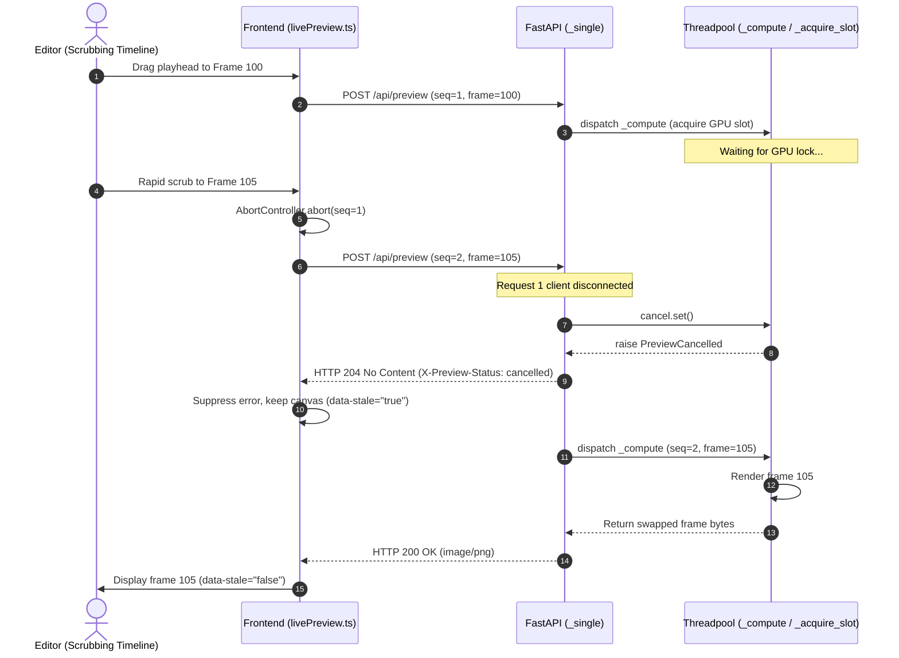

# Roop 3D Workstation Modernization & UI Repair

*   **Author:** rishabh4496
*   **Status:** Approved
*   **Date:** 2026-11-03

--------------------------------------------------------------------------------

## Overview

This technical design defines the architectural overhaul of the Roop 3D workstation frontend (`app/roop_3d_ui`) and its coordination contracts with the local server (`roop_3d.server`). The project transforms Roop 3D into a responsive, high-contrast dark glassmorphic post-production environment equipped with functional 3D spatial tools (Head Pose Gizmo, Spherical Harmonics Lighting Probe, FLAME Mesh Inspection) and a categorized, live-validated Settings Inspector. Concurrently, it resolves critical runtime failures in live swap preview concurrency (HTTP 409/422) and FaceSet extraction contracts, establishing dedicated operational budgets for RTX 3060 (6 GB) and RTX 4070 (12 GB) hardware.

To prevent instability and regression, implementation is organized into five sequential phases:
1. **Phase 1: Concurrency & Contract Fixes** — Benign preview cancellation (`PreviewCancelled` exception / HTTP 204), `ExtractRequest.faceset_id` alignment, and `/faces/bank/discover` inspection auto-lookup.
2. **Phase 2: Memory & Hardware Profiles** — Canonical `6gb` and `12gb` profiles with ONNX Runtime session memory clamping (`gpu_mem_limit: 4823449600`) and inter-stage memory management.
3. **Phase 3: Settings De-monolithing** — Decompose `SettingsInspector.tsx` into 5 domain tabs with reactive client-side validation while preserving the Stage 11 zero-render invariant.
4. **Phase 4: Functional 3D Spatial Tools** — Unified single-context `SpatialInspector.tsx` with lazy-mounted sub-tabs (`HeadPoseTab`, `LightingProbeTab`, `FlameMeshTab`), Tanner Helland Kelvin conversion, and dual-endpoint FLAME mesh/coverage visualization.
5. **Phase 5: Dark Glassmorphic Styling** — Theme-tokenized CSS glass system with light-theme inverted tokens and solid fallback under `[data-perf-mode="high"]`.

## The Problem

1. **Live Swap Preview Request Collisions (HTTP 409 & 422):** Rapid playhead scrubbing and parameter slider adjustments trigger rapid bursts of `POST /api/preview` calls. When `AbortController.abort()` cancels in-flight requests on the client, the server currently raises `DomainError("PREVIEW_CANCELLED", 409)` inside threadpool slots, presenting users with false error banners. Furthermore, payload schema mismatches during media switching cause HTTP 422 unprocessable entity rejections, breaking the preview canvas.
2. **Face Extraction & Bank Discovery Contract Desync (HTTP 422):** Contract discrepancies between frontend requests and backend Pydantic validators cause face harvesting to fail:
   * `/faces/extract_from_frame` lacks `faceset_id` in `ExtractRequest`, failing validation when saving to active FaceSets.
   * `/faces/bank/discover` rejects requests with HTTP 422 `INSPECTION_NOT_FOUND` when the client passes stale or omitted `inspection_id` values instead of resolving the latest inspection from `target_path`.
3. **Monolithic & Unvalidated Settings Panel:** `SettingsInspector.tsx` currently renders a flat JSON schema list without functional grouping, real-time validation, or clear persistence indicators, leaving users unable to configure or verify engine, hardware, or 3D settings reliably.
4. **GPU Compositor & WebGL Context Contention:** Unconstrained CSS backdrop blurs and concurrent `@react-three/fiber` canvases fight for GPU memory bandwidth and fillrate against PyTorch/TensorRT inference on consumer GPUs (especially RTX 3060 6 GB), triggering UI frame drops and WebGL context loss.

## Goals

*   **Concurrency Resilience:** Eliminate HTTP 409 `PREVIEW_CANCELLED` errors by implementing benign cancellation protocols on both client and server: threadpool slots raise `PreviewCancelled` caught by async handlers returning `HTTP 204 No Content`.
*   **Payload Contract Alignment:** Resolve all HTTP 422 validation errors across `/api/preview`, `/faces/extract_from_frame` (adding `faceset_id`), and `/faces/bank/discover` (auto-lookup of latest target inspection) through client sanitization and spatial centroid matching bounded by $d_{\max} \le 0.15 \times \text{frame diagonal}$.
*   **Dual-Tier Hardware Profiling:** Implement dedicated memory management profiles: a clamped 4,600 MiB Low-VRAM profile for RTX 3060 (`6gb`) with ONNX session memory clamping and sequential execution, and an unthrottled resident-engine profile for RTX 4070 (`12gb`).
*   **Categorized Settings Architecture:** Replace the monolithic schema list with 5 domain-specific, reactive panels (Compute & Engine, 3D Spatial Synthesis, Stream Pipeline, Finishing, Workstation UX) with real-time constraint validation, while preserving the Stage 11 zero-render invariant by decoupling from `telemetryStore`.
*   **Functional 3D Spatial Utilities:** Deliver interactive Three.js tools (3D Head Pose Gizmo, Spherical Harmonics L2 Lighting Probe, FLAME Mesh Viewer) hosted within a single-context tabbed `SpatialInspector.tsx` with strict WebGL lifecycle management (`renderer.forceContextLoss()`, `geometry.dispose()`).
*   **Dark Glassmorphic UI System:** Implement a theme-tokenized CSS glass design system supporting all 37 themes (including light-theme inverted tokens) that drops to solid panels under `[data-perf-mode="high"]` without degrading video playback frame rates.
*   **Test Suite Preservation:** Maintain a 100% pass rate across all 37 Vitest test suites (317 tests) and backend pytest suites (`liveSwapPreview.test.tsx`, `test_live_preview.py`).

## Non-Goals

*   Applying CSS `backdrop-filter: blur(...)` directly over active WebGL video playback canvases or high-frequency inspection viewports.
*   Decorative background 3D scenes or long transition animations that introduce input latency during editing operations.
*   Modifying low-level PyTorch/TensorRT model weights or underlying neural network topologies.
*   Altering Pinokio daemon lifecycle scripts, root launcher structures, or default service ports (FastAPI on 8030, Vite on 5174).

## Open Questions

*   **Question 1 (Hardware Profile Engagement):** Should the 6 GB Low-VRAM profile engage automatically based on runtime telemetry, or remain an explicit manual selection in Settings with an automated safety fallback?
    * **Status:** `Resolved`. Default to automatic hardware detection on startup (`auto` resolving to `6gb` or `12gb` based on physical GPU VRAM). Provide an explicit manual override dropdown in Settings (`auto`, `6gb`, `12gb`). Updating `hardware_profile` via `/api/v1/config` applies immediately to subsequent preview dispatches; active render jobs retain their launch profile until completion.
*   **Question 2 (Target Media Transition State):** When a user switches to a new target video, should existing FaceSet cluster assignments attempt nearest-neighbor spatial matching on the first frame, or reset completely to prevent stale track mappings?
    * **Status:** `Resolved`. Automatically purge stale track mappings upon target media transition. The client resets `target_face_id` and track maps when `inspection_id` changes, prompting the user to select fresh tracks or run discovery on the new target media.

## Critical User Journeys (CUJs)

### CUJ 1: High-Frequency Timeline Scrub & Live Swap Preview

*   **Given**: An RTX 3060 (6 GB) environment with an active target video and mapped FaceSet in Studio layout mode.
*   **When**: The user rapidly scrubs the playhead across multiple timeline chapters and keyframes.
*   **Then**: In-flight preview requests are benignly cancelled without displaying HTTP 409 error banners. Scrub preview executes at 0.5x resolution with restoration bypassed, the server returns HTTP 204 for cancelled slots, and full-resolution swapped frames settle cleanly within 250ms of playhead release.

### CUJ 2: Interactive 3D Head Pose & Lighting Alignment

*   **Given**: A source FaceSet being aligned with target facial geometry in the 4-panel Studio view.
*   **When**: The user drags the 3D Head Pose Gizmo to adjust yaw/pitch/roll and positions the key-light indicator on the Spherical Harmonics lighting probe.
*   **Then**: Numerical angles synchronize bidirectionally with `useFaceSelectionStore.focusPose` and pass via `pose_override` to preview requests. Lighting parameters update scene relighting in real time via Tanner Helland Kelvin-to-RGB conversion, and all WebGL resources are safely reclaimed upon panel unmount.

### CUJ 3: Domain-Validated Settings Configuration

*   **Given**: The user navigates to the redesigned Settings screen.
*   **When**: The user switches between categorized tabs (Compute, 3D Spatial, Pipeline, Finishing, UX) and modifies execution parameters (e.g., selecting `TensorrtExecutionProvider`).
*   **Then**: Real-time validation verifies hardware compatibility (reading model compilation state from `/api/v1/system/capabilities`), displays inline remediation hints for incompatible options, and persists valid configurations immediately to `/api/v1/config` without triggering re-renders from telemetry streams.

--------------------------------------------------------------------------------

## Technical Plan (Architecture)

### 1. Architectural Overview & Component Diagram

The modernization updates coordination across the frontend workstation, API server gate, and hardware execution layers. Legacy unversioned route aliases (`/api/preview`, `/faces/extract_from_frame`, etc.) are maintained alongside versioned `/api/v1/...` routes via routing middleware to ensure backward compatibility.

```mermaid
flowchart TD
    subgraph Client["Frontend Workstation (React 19 / Vite 5174)"]
        UI_Theme["Theme-Tokenized Glass Shell\n(data-perf-mode · Scoped Filters)"]
        Preview_Mgr["Preview Manager\n(Sequence Counter + Benign Abort)"]
        Spatial_Suite["Spatial Inspector (Single WebGL Context)\n(Head Pose · SH Probe · FLAME)"]
        Settings_UI["Categorized Settings Inspector\n(5 Domain Panels · Telemetry Decoupled)"]
    end

    subgraph Server["FastAPI Gateway (127.0.0.1:8030)"]
        Preview_Route["/api/preview & /api/v1/preview\n(PreviewCancelled -> HTTP 204)"]
        Extract_Route["/faces/extract_from_frame\n(faceset_id · Bounded Centroid)"]
        Bank_Route["/faces/bank/discover\n(Auto-lookup Latest Inspection)"]
        Config_Route["/api/v1/config Handler\n(Domain Partitioning + Validation)"]
        HW_Mgr["Hardware Profile Controller\n(6gb Clamped vs. 12gb Resident)"]
    end

    subgraph Inference["Inference & Render Engine"]
        TRT_Engines["TensorRT Execution Provider\n(12gb Profile Resident Models)"]
        Sequential_CUDA["Sequential CUDA Pipeline\n(6gb Profile ONNX Mem Clamped)"]
        FLAME_Recon["FLAME 3D Reconstruction Asset Store\n(Mesh Geometry + Coverage Metrics)"]
    end

    UI_Theme --> Preview_Mgr
    Spatial_Suite --> Preview_Mgr
    Preview_Mgr -->|POST /api/preview (seq)| Preview_Route
    Settings_UI -->|POST /api/v1/config| Config_Route
    Preview_Route --> HW_Mgr
    Extract_Route --> FLAME_Recon
    Bank_Route --> Extract_Route
    HW_Mgr -->|RTX 4070 (12gb)| TRT_Engines
    HW_Mgr -->|RTX 3060 (6gb)| Sequential_CUDA
```

### 2. Frontend Subsystems (`app/roop_3d_ui/src/`)

#### 2.1 Concurrency & Live Preview Queue (`livePreview.ts`, `VideoViewport.tsx`)
* **Request Sequencing (`seq`):** A monotonically increasing sequence number tags each preview dispatch. If a newer scrub tick or slider move occurs while request `N` is pending, request `N` is aborted via `AbortController`.
* **Benign Abort Suppression:** Catching `AbortError` / `DOMException` or receiving HTTP 204 from the server will no longer surface toast error banners or clear the canvas. The client retains the rendered canvas in a stale state (`data-stale="true"`) until request `N+1` returns an image.
* **Low-VRAM Scrub Proxying:** When the `6gb` profile is active:
  * In-motion scrub sends a lightweight preview request: image resolution scaled to 50%, face restorers (GPEN/CodeFormer) bypassed.
  * Settle timer (250ms debounce after mouse-up or arrow key release) dispatches the full-fidelity preview request.
* **WorkstationParameters State Architecture:** `WorkstationParameters` (defined in `components/workstation/pipeline.ts`) serves as the authoritative typed parameter object for live preview and final render generation. UI manipulators (sliders, color pickers, 3D gizmos) update atomic store drafts (`useFaceSelectionStore`, `useWorkstationStore`) unidirectionally. On dispatch, the active draft serializes into `LivePreviewPayload`, passing overrides (e.g. `pose_override`) to `/api/preview`.



#### 2.2 Functional 3D Spatial Tools
* **Single-Context Unified Spatial Inspector (`components/studio/SpatialInspector.tsx`):**
  * Consolidates all 3D inspection tools into a single container with tabbed views: `HeadPoseTab`, `LightingProbeTab`, and `FlameMeshTab`.
  * To prevent WebGL context exhaustion on 6 GB RTX 3060 systems during inference, only one auxiliary 3D WebGL context is active at any time. Unmounting a tab invokes `renderer.forceContextLoss()`, `renderer.dispose()`, and explicit `geometry.dispose()` / `material.dispose()`.
* **Interactive Head Pose Gizmo (`components/studio/PoseGeometryViewer.tsx`):**
  * Powered by `@react-three/fiber` and Three.js with an unlit low-poly anatomical head mesh.
  * Interactively binds yaw (green), pitch (red), and roll (blue) gimbal rings. Rotation updates are converted from Euler to Quaternion and debounced into `useFaceSelectionStore.focusPose` and passed via `pose_override: { yaw, pitch, roll }` in preview payloads.
* **Spherical Harmonics (SH L2) Lighting Probe (`components/studio/LightProbeSphere.tsx`):**
  * Replaces static vector indicators with a dynamic WebGL sphere displaying 9-coefficient irradiance.
  * An interactive key-light manipulator computes spherical coordinates (azimuth, elevation) and writes `manual_light_yaw`, `manual_light_pitch`, and color temperature (Kelvin 2000K–10000K) to the relighting pass.
  * **Tanner Helland Kelvin-to-RGB Conversion:** The color temperature is converted to normalized RGB scaling factors $(r, g, b)$ using the Tanner Helland blackbody algorithm:
    $$T = \frac{K}{100}$$
    $$\text{Red: } \begin{cases} 255 & T \le 66 \\ \text{clamp}(329.698727446 \cdot (T - 60)^{-0.1332047592}, 0, 255) & T > 66 \end{cases}$$
    $$\text{Green: } \begin{cases} \text{clamp}(99.4708025861 \cdot \ln(T) - 161.1195681661, 0, 255) & T \le 66 \\ \text{clamp}(288.1221695283 \cdot (T - 60)^{-0.0755148492}, 0, 255) & T > 66 \end{cases}$$
    $$\text{Blue: } \begin{cases} 0 & T \le 19 \\ \text{clamp}(138.5177312231 \cdot \ln(T - 10) - 305.0447927307, 0, 255) & 19 < T < 66 \\ 255 & T \ge 66 \end{cases}$$
    The normalized factors $(r/255, g/255, b/255)$ modulate directional $L_1$ and ambient $L_0^0$ Spherical Harmonics coefficients directly.
* **FLAME Parametric Mesh Inspection (`components/studio/FlameMeshViewer.tsx`):**
  * Retrieves 5,023-vertex FLAME geometry from `GET /api/v1/facesets/{id}/identity-asset/mesh` (providing vertices, uvs, texture).
  * Concurrently fetches pose coverage confidence metrics from `GET /api/v1/facesets/{id}/coverage`.
  * Maps coverage cell scores onto corresponding facial mesh vertex regions to render interactive confidence heatmaps.
* **State Management Architecture:**
  * Uses Custom `useSyncExternalStore` Atomic Stores (`createAtomicStore`), completely avoiding external Zustand dependencies in accordance with repository constraints.

#### 2.3 Categorized Settings Inspector (`SettingsInspector.tsx`)
* **Zero-Render Telemetry Invariant:**
  * To preserve the Stage 11 performance guarantee verified in `stage11Perf.test.tsx` (strictly asserting 0 re-renders of `SettingsInspector` during 30 Hz telemetry streaming), `SettingsInspector` remains strictly decoupled from `telemetryStore`.
  * Telemetry monitoring is restricted to dedicated leaf components (`GpuReadout`, `PipelinePill`). Settings toggles only read and write static configuration parameters.
* **Domain Partitioning & Schema Mapping:**
  * Decomposes the monolithic schema into 5 validated tabs:
    1. `ComputeSettingsSection`: Execution providers, hardware profiles, VRAM limits.
    2. `Spatial3DSettingsSection`: FLAME fitting tolerance, 2.5D TPS fallback thresholds, pose hysteresis.
    3. `PipelineSettingsSection`: Execution threads, ring buffers, streaming batch sizes.
    4. `FinishingSettingsSection`: Restoration policies, lip-sync mode, video/audio timing.
    5. `WorkstationUXSection`: Glass blur intensity slider, antialiasing, theme picker.
* **2.5D Thin Plate Spline (TPS) Fallback:**
  * A 2D landmark-driven warping approximation used when 3D FLAME mesh fitting fails to converge or exceeds error tolerances.
* **Reactive Validation Engine:**
  * Inspects `caps.models[*].state` from `/api/v1/system/capabilities` to determine if TensorRT engines are built before allowing `TensorrtExecutionProvider` selection.
  * Disables invalid combinations with inline remediation explanations.
* **Hardware Profile Enum Alignment:**
  * Retains canonical schema values: `Literal["auto", "cpu", "6gb", "12gb"]`.
  * Renders human-friendly UI labels: "Auto Detect", "CPU Only", "6 GB Low-VRAM", "12 GB Standard".

#### Settings Section-to-Schema Key Mapping Table

| Domain Section | Settings Schema Keys (`Settings.model_json_schema()`) | UI Input Type & Validation Rules |
| :--- | :--- | :--- |
| **Compute & Engine** | `execution_mode`, `hardware_profile`, `preferred_provider`, `precision_policy`, `vram_limit_mb`, `memory_safety_reserve_mb`, `max_concurrent_jobs`, `render_backend` | Enum selects, numeric inputs with physical VRAM ceiling validation. TRT disabled if `caps.models[*].state != "ready"`. |
| **3D Spatial Synthesis** | `temporal_min_cutoff`, `temporal_beta`, `temporal_d_cutoff`, `pose_hysteresis_degrees`, `auxiliary_offload_enabled` | Float sliders with bounds checking: `temporal_beta` (0.0–10.0), `pose_hysteresis` (0.0–9.99°). |
| **Stream Pipeline** | `execution_threads`, `stream_batch_size`, `stream_ring_slots`, `stream_segment_frames`, `sparse_interval`, `restorer_threads`, `restorer_pool_size` | Integer steppers: `stream_batch_size` (1–8), `stream_ring_slots` (2–32). |
| **Finishing** | `face_restoration_policy`, `video_timing_policy`, `audio_policy`, `lip_sync_mode`, `ultramax_native_bypass`, `ultramax_min_pixels` | Dropdown policies: restorers (`off`, `gpen`, `codeformer`, `gfpgan`, `ultramax`), pixel thresholds (320–4096 px). |
| **Workstation UX** | `synthetic_media_notice`, `diagnostics_level` *(UI-only: glass blur slider, theme picker)* | Checkboxes, level selects (`info`, `debug`, `warning`, `error`). Glass intensity slider drives `--glass-blur-radius`. |
| **System & Advanced (Fallback)** | `host`, `port`, `max_body_bytes`, `dev_cors`, `heterogeneous_split_mode`, `openvino_device`, `qsv_offload_enabled`, `output_root`, `cache_root`, `model_search_paths`, `remote_processing_enabled` | Read-only runtime network parameters, path configuration, and hardware offload toggles. |

#### 2.4 Tokenized Dark Glassmorphic Design System (`styles.css`, `themes.ts`, `themeVars.ts`)
* **CSS Custom Property Foundations:**
  ```css
  :root {
    --surface-glass: rgba(18, 24, 27, 0.72);
    --surface-glass-raised: rgba(29, 38, 40, 0.78);
    --glass-blur: blur(12px) saturate(180%);
    --glass-border: 1px solid rgba(255, 255, 255, 0.08);
    --glass-specular: inset 0 1px 0 rgba(255, 255, 255, 0.06);
    --glass-glow: 0 8px 32px 0 rgba(0, 0, 0, 0.37);
  }
  ```
* **Light Theme Adaptations:**
  * When `mode === 'light'`, `deriveThemeVars` computes inverted white-glass tokens:
    ```css
    --surface-glass: rgba(255, 255, 255, 0.75);
    --surface-glass-raised: rgba(245, 247, 248, 0.85);
    --glass-border: 1px solid rgba(0, 0, 0, 0.08);
    --glass-specular: inset 0 1px 0 rgba(255, 255, 255, 0.6);
    --glass-glow: 0 8px 32px 0 rgba(0, 0, 0, 0.08);
    ```
* **Performance Mode Decoupling via DOM Attribute:**
  * Performance mode is signaled via the DOM attribute `[data-perf-mode="high"]` on the root application container.
  * When `[data-perf-mode="high"]` is present or during active export rendering, `--glass-blur: none`, transforming translucent glass surfaces into opaque dark panels (`rgba(18, 24, 27, 0.98)`).
  * Video playback canvases and WebGL viewports are strictly isolated with `backdrop-filter: none; contain: paint;` to guarantee 60 FPS playback on 6 GB GPUs.

### 3. Backend Subsystems (`app/roop_3d/server/`)

#### 3.1 Preview Slot & Cancellation Management (`server/live_preview.py`, `server/engine_gate.py`)
* **Threadpool Cancellation Protocol:**
  * `_acquire_slot(cancel: Event)` runs synchronously inside `run_in_threadpool`. When `cancel.is_set()` fires during lock acquisition or execution, it raises a dedicated `PreviewCancelled` exception.
  * The async route handler `_single()` catches `PreviewCancelled` and returns `Response(status_code=204, headers={"X-Preview-Status": "cancelled"})` rather than raising `DomainError("PREVIEW_CANCELLED", 409)`.
* **Atomic Worker Release:** Releasing the GPU execution slot occurs immediately in the `finally` block of the request lifecycle, ensuring incoming superseding requests are never blocked by cancelled frames.

#### 3.2 Face Extraction & Bank Alignment (`server/face_extract.py`, `server/face_bank.py`)
* **Pydantic Validation Flexibility:** In `ExtractRequest` (`server/face_extract.py`), declare:
  ```python
  faceset_id: str | None = Field(default=None, pattern=r"^[A-Za-z0-9_-]{1,64}$")
  ```
  Update `@model_validator(mode="after")` to verify `faceset_id or faceset_name` when `destination == "active_faceset"`.
* **Spatial Centroid Matching with Distance Cutoff:** Alongside `face_index`, `ExtractRequest` accepts optional normalized face centroid coordinates `(norm_cx, norm_cy)`. If detector face ordering shifts between video frame decoding and frontend inspection, the backend matches the face with the minimum Euclidean centroid distance, bounded by:
  $$d_{\max} \le 0.15 \times \text{frame diagonal}$$
  If no detected face falls within $d_{\max}$, the server returns `DomainError("FACE_NOT_FOUND", 422)`.
* **Bank Discovery Auto-Lookup (`server/face_bank.py`):**
  * In `DiscoverBank`, relax validation: if `inspection_id` is omitted or stale, look up the latest valid inspection for `target_media_path` via its SHA-256 target digest rather than throwing HTTP 422 `INSPECTION_NOT_FOUND`.

#### 3.3 Hardware Memory Management (`core/hardware.py`, `server/diagnostics.py`)
* **Hardware Profiles:**
  * `12gb`: Keeps ONNX/TRT engines resident in VRAM (~8.5 GB allocated), allowing full 1080p real-time live preview.
  * `6gb`: Hard ceiling of 4,600 MiB VRAM. Models are phased sequentially (Detection -> Swapping -> Enhancement).
* **ONNX Runtime Session Memory Clamping:**
  * On the `6gb` profile, configure ONNX Runtime session options with `gpu_mem_limit: 4823449600` (4,600 MiB) and `arena_extend_strategy: "kSameAsRequested"` to prevent unconstrained BFCArena growth. Unbind and recreate sessions between stages rather than relying solely on `torch.cuda.empty_cache()`.
* **Dynamic Profile Switching:** Updating `hardware_profile` via `/api/v1/config` applies immediately to subsequent preview dispatches; active render jobs retain their launch profile until completion.

#### 3.4 Route Compatibility & Aliasing
* Legacy unversioned routes (`/api/preview`, `/faces/extract_from_frame`, `/faces/bank/discover`) coexist alongside versioned routes (`/api/v1/...`) via router mounting and alias middleware, guaranteeing zero disruption to existing Playwright tests and third-party integrations.

--------------------------------------------------------------------------------

## Alternatives Considered

### Alternative A: Full CSS Backdrop Blur on All Viewport Panels
*   **Pros**: Provides a uniform, highly stylized glassmorphic aesthetic across the entire application interface.
*   **Cons**: Chromium's compositor allocates offscreen surfaces for each blurred element. When layered on top of active video playback and WebGL canvases, display frame rates drop from 60 FPS to under 28 FPS on 6 GB GPUs, contending directly with CUDA compute tasks.
*   **Reason for Rejection**: Full-viewport CSS blurs degrade video playback performance and induce GPU memory bandwidth bottlenecks during concurrent TensorRT/CUDA inference.

### Alternative B: Monolithic Settings Form (Status Quo)
*   **Pros**: Requires no alterations to the existing dynamic JSON schema generation pipeline or backend schema endpoints.
*   **Cons**: Renders dozens of unrelated configuration properties in a single flat list, creating high cognitive load, obscuring invalid parameter combinations, and failing to provide live persistence feedback.
*   **Reason for Rejection**: An unorganized flat list makes parameter tuning error-prone, fails to validate hardware dependencies, and obscures active engine states.

### Alternative C: Continuous Background Three.js 3D Scene
*   **Pros**: Delivers a futuristic 3D ambient atmosphere with dynamic procedural lighting and particle effects.
*   **Cons**: Continuous WebGL animation loops consume dedicated GPU draw cycles and VRAM even when the application is idle, competing with model inference.
*   **Reason for Rejection**: Dedicated GPU resources must be preserved for video decoding and neural network execution; decorative background 3D rendering provides zero utility to post-production workflows.

### Alternative D: Client-Only Error Masking for Live Preview
*   **Pros**: Minimizes implementation effort by catching and suppressing HTTP 409 and 422 responses exclusively within the frontend `fetch()` wrapper.
*   **Cons**: Leaves the backend preview worker thread busy executing orphaned, cancelled frames, causing subsequent user preview requests to hit `PREVIEW_BUSY` slot exhaustion.
*   **Reason for Rejection**: Client-side error suppression does not free server worker capacity; the server must coordinate atomic slot releases and return non-error cancellation statuses.

--------------------------------------------------------------------------------

## Non-Functional Requirements

### 1. Security & Privacy
* **Loopback Boundary:** The service remains strictly bound to `127.0.0.1` (API default 8030). No remote telemetry, analytics, or media egress is permitted.
* **Consent Verification:** Biometric consent invariants (`remote_consent: false`, `processing: "local"`) are preserved across all job and preview requests.

### 2. Performance & Hardware Latency
* **Memory Headroom:** Total VRAM consumption on the `6gb` profile is strictly clamped to $\le$ 4,600 MiB, leaving $\ge$ 1,500 MiB for the host operating system DWM and browser WebGL context.
* **Preview Settle Time:** Playhead scrubbing settle latency must not exceed 250ms from mouse-up to full-resolution swap frame delivery.
* **Compositor Overhead:** UI glass surfaces must not exceed 2.0ms per-frame paint time in Chrome DevTools performance traces.

### 3. Reliability & Rollout Safety
* **Zero Test Regressions:** All 37 Vitest test suites (317 tests) and backend pytest suites must pass without regression.
* **Schema Backward Compatibility:** Restructuring `SettingsInspector` must produce output payloads fully conforming to existing `/api/v1/config` JSON schemas without breaking saved project files.

--------------------------------------------------------------------------------

## Detailed Implementation Plan

### Target Files to Create/Modify

#### 1. `app/roop_3d_ui/src/livePreview.ts` (Modify)
* **Type / Scope:** Frontend Network Queue Module
* **Proposed Changes & Rationale:**
  * Implement sequence counter tracking (`activeSequenceId`) to identify the newest dispatch.
  * Integrate `AbortController` cancellation that treats HTTP 204 or `AbortError` / `DOMException` benignly, keeping stale canvas frames without error alerts.
  * Add support for proxy downscaling payloads (`width`, `height`, `bypass_restoration`) to support lightweight scrub preview.
  * *Rationale:* Eliminates false user-facing error banners and unblocks preview canvas rendering during rapid playhead scrubs.

#### 2. `app/roop_3d/server/live_preview.py` (Modify)
* **Type / Scope:** FastAPI Route Handler (`POST /api/preview`)
* **Proposed Changes & Rationale:**
  * Define `PreviewCancelled(Exception)`. In `_acquire_slot()`, detect `cancel.is_set()` and raise `PreviewCancelled`.
  * In async route handler `_single()`, catch `PreviewCancelled` and return `Response(status_code=204, headers={"X-Preview-Status": "cancelled"})` rather than raising `DomainError("PREVIEW_CANCELLED", 409)`.
  * Ensure immediate slot release in the `finally` block of `_compute()`.
  * *Rationale:* Prevents the backend from registering benign client cancellations as server errors and immediately unlocks the GPU slot for incoming frames.

#### 3. `app/roop_3d_ui/src/useFaceSelectionStore.ts` (Modify)
* **Type / Scope:** Atomic State Store (`useSyncExternalStore`)
* **Proposed Changes & Rationale:**
  * Add automatic mapping sanitation when `inspection_id` changes to drop tracks belonging to prior videos.
  * Track `focusPose: { yaw: number, pitch: number, roll: number }` for 3D gizmo synchronization.
  * Add optional normalized centroid coordinates `(norm_cx, norm_cy)` to face extraction request drafts.
  * *Rationale:* Eliminates HTTP 422 unprocessable entity errors caused by stale track references upon target switching.

#### 4. `app/roop_3d/server/face_extract.py` & `app/roop_3d/server/face_bank.py` (Modify)
* **Type / Scope:** FastAPI Face Extraction & Discovery Endpoints
* **Proposed Changes & Rationale:**
  * In `server/face_extract.py`, declare `faceset_id: str | None = Field(default=None, pattern=r"^[A-Za-z0-9_-]{1,64}$")` on `ExtractRequest`. Update `@model_validator` to verify `faceset_id or faceset_name` when `destination == "active_faceset"`.
  * Add Euclidean centroid fallback matching: when detected face count or ordering differs from client inspection landmarks, match the detected face with minimum Euclidean distance to `(norm_cx, norm_cy)`, bounded by $d_{\max} \le 0.15 \times \text{frame diagonal}$.
  * In `server/face_bank.py`, relax discovery request validation: when `target_path` is provided, if `inspection_id` is omitted or stale, look up the latest inspection for `target_path` rather than throwing HTTP 422.
  * *Rationale:* Resolves HTTP 422 rejections during face harvesting and cluster discovery.

#### 5. `app/roop_3d_ui/src/SettingsInspector.tsx` (Modify)
* **Type / Scope:** React UI Component
* **Proposed Changes & Rationale:**
  * Decompose monolithic schema into five domain sections: Compute & Engine, 3D Spatial Synthesis, Stream Pipeline, Finishing, and Workstation UX.
  * Strictly decouple from `telemetryStore` to preserve Stage 11 zero-render invariants (0 re-renders at 30 Hz).
  * Retain canonical schema enums (`"auto"`, `"cpu"`, `"6gb"`, `"12gb"`), mapping to user-friendly UI labels.
  * Implement client-side relational constraint validation (e.g., checking `caps.models[*].state` before enabling TensorRT, warning on VRAM limits > physical VRAM).
  * *Rationale:* Solves cognitive overload, prevents invalid execution configurations, and preserves performance benchmarks.

#### 6. `app/roop_3d_ui/src/components/studio/SpatialInspector.tsx` & `PoseGeometryViewer.tsx` (Create)
* **Type / Scope:** Unified Three.js / React Three Fiber Spatial Component
* **Proposed Changes & Rationale:**
  * Create `SpatialInspector.tsx` managing a single shared WebGL context across three sub-tabs (`HeadPoseTab`, `LightingProbeTab`, `FlameMeshTab`).
  * In `PoseGeometryViewer.tsx`, render an interactive canonical 3D low-poly head mesh.
  * Bind yaw, pitch, and roll rotation rings with Euler/Quaternion synchronization to `useFaceSelectionStore.focusPose` and pass `pose_override` to preview payloads.
  * Enforce explicit `renderer.forceContextLoss()`, `renderer.dispose()`, and `geometry.dispose()` on tab unmount.
  * *Rationale:* Replaces static text fields with an interactive spatial manipulator for 3D face alignment while preventing WebGL context loss on 6 GB RTX 3060.

#### 7. `app/roop_3d_ui/src/components/studio/LightProbeSphere.tsx` (Create)
* **Type / Scope:** WebGL Lighting Component
* **Proposed Changes & Rationale:**
  * Build an interactive WebGL sphere rendering 9-coefficient L2 spherical harmonic irradiance.
  * Implement interactive key-light handle setting azimuth, elevation, and Kelvin temperature (2000K–10000K).
  * Integrate Tanner Helland Kelvin-to-RGB conversion to modulate directional $L_1$ and ambient $L_0^0$ SH coefficients.
  * *Rationale:* Provides direct interactive lighting matching for seamless face swap blending.

#### 8. `app/roop_3d_ui/src/components/studio/FlameMeshViewer.tsx` (Create)
* **Type / Scope:** Three.js Mesh Inspection Component
* **Proposed Changes & Rationale:**
  * Render 5,023-vertex FLAME geometry retrieved from `GET /api/v1/facesets/{id}/identity-asset/mesh`.
  * Concurrently fetch pose coverage confidence metrics from `GET /api/v1/facesets/{id}/coverage` and map coverage cell scores onto facial vertex heatmaps.
  * Implement strict WebGL resource disposal (`geometry.dispose()`, `material.dispose()`) upon unmount.
  * *Rationale:* Enables direct inspection of 3D facial fitting accuracy while preventing WebGL memory leaks.

#### 9. `app/roop_3d_ui/src/styles.css` (Modify)
* **Type / Scope:** Workstation Styling Tokens
* **Proposed Changes & Rationale:**
  * Declare tokenized CSS variables: `--surface-glass`, `--surface-glass-raised`, `--glass-blur`, `--glass-border`, `--glass-specular`, `--glass-glow`.
  * Scope blurs to elevated panels while keeping video/WebGL viewports blur-free (`contain: paint`).
  * Implement high-performance solid fallback when `[data-perf-mode="high"]` is set on the root container.
  * *Rationale:* Establishes a modern dark glass aesthetic without degrading video playback FPS.

#### 10. `app/roop_3d_ui/src/themeVars.ts` & `app/roop_3d_ui/src/themes.ts` (Modify)
* **Type / Scope:** Theme Recipe Engine
* **Proposed Changes & Rationale:**
  * Update `deriveThemeVars` to compute theme-aware translucent glass surfaces and specular rim highlights derived dynamically from `currentTheme.bg` and `currentTheme.accent`.
  * Support inverted white-glass tokens (`rgba(255, 255, 255, 0.75)`) when `mode === 'light'`.
  * *Rationale:* Guarantees high-contrast readability across all 37 dark, AMOLED, and light themes.

#### 11. `app/roop_3d/core/hardware.py` & `app/roop_3d/server/diagnostics.py` (Modify)
* **Type / Scope:** Backend Hardware Abstraction & Telemetry
* **Proposed Changes & Rationale:**
  * Formalize canonical `6gb` (4,600 MiB ceiling, ONNX Runtime session clamping with `gpu_mem_limit: 4823449600`, sequential pipeline, inter-stage session unbind) and `12gb` (8,500 MiB resident target) profiles.
  * Support dynamic runtime profile switching without requiring full daemon restart.
  * Expose active hardware profile in `/api/v1/system/capabilities`.
  * *Rationale:* Guarantees safe execution on RTX 3060 6 GB while allowing full speed on RTX 4070 12 GB.

#### 12. `app/roop_3d_ui/src/liveSwapPreview.test.tsx` (Modify)
* **Type / Scope:** Unit Test Suite
* **Proposed Changes & Rationale:**
  * Add test cases asserting that cancelled preview dispatches (HTTP 204 or `AbortError`) suppress error toasts and maintain stale canvas rendering without error banners.
  * *Rationale:* Prevents regressions in preview cancellation handling.

#### 13. `app/roop_3d_ui/src/settingsAndSweep.test.tsx` (Modify)
* **Type / Scope:** Unit Test Suite
* **Proposed Changes & Rationale:**
  * Add test assertions for domain tab navigation, schema mapping completeness, and reactive validation rules in `SettingsInspector`.
  * *Rationale:* Ensures the decomposed settings structure preserves contract integrity and passing test suites.

#### 14. `app/roop_3d/tests/test_live_preview.py` (Modify)
* **Type / Scope:** Backend Unit Test Suite
* **Proposed Changes & Rationale:**
  * Add test cases verifying that client cancellation raises `PreviewCancelled` and returns `HTTP 204 No Content` with header `X-Preview-Status: cancelled`.
  * *Rationale:* Guarantees backend concurrency protocol integrity.

### Verification Plan

*   **Compilation & Build:**
    *   Frontend typecheck: `npm --prefix app/roop_3d_ui run typecheck` (zero TypeScript errors).
    *   Frontend production build: `npm --prefix app/roop_3d_ui run build` (successful compilation of `dist/`).
*   **Unit & Integration Test Suites:**
    *   Run frontend Vitest suite: `npm --prefix app/roop_3d_ui test` (all 37 test files, 317+ tests passing).
    *   Run backend test suite: `app/roop_3d/.venv/Scripts/python.exe -B -m pytest -c app/roop_3d/pyproject.toml --confcutdir=app/roop_3d app/roop_3d/tests -q`.
*   **Static Analysis & Linting:**
    *   Frontend lint: `npm --prefix app/roop_3d_ui run lint`.
*   **End-to-End Concurrency & Profile Verification:**
    *   Verify benign preview cancellation handling in `app/roop_3d_ui/src/liveSwapPreview.test.tsx` and `app/roop_3d/tests/test_live_preview.py`.
    *   Verify memory ceiling enforcement on `6gb` profile using diagnostic memory benchmarks.

--------------------------------------------------------------------------------

*Drafted with EGM*
